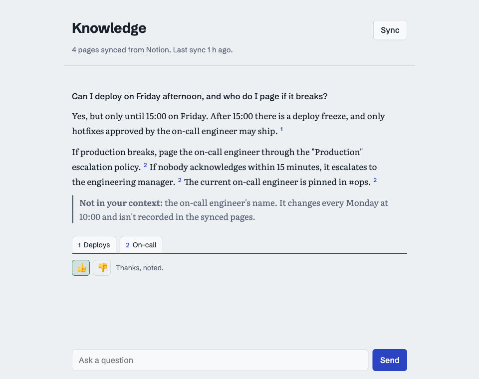
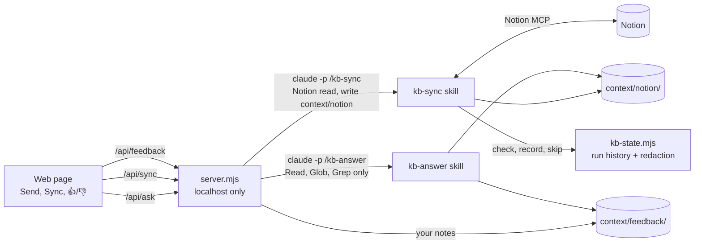

# Internal Knowledge Harness

Ask questions about your Notion workspace and get answers **only** from your own pages, with a citation for every claim. When the answer isn't in your pages, it says so instead of guessing.

It runs on your machine: a single-page website drives [Claude Code](https://docs.claude.com/en/docs/claude-code/overview) through two skills, one that syncs Notion into local Markdown and one that answers from it. A thumbs-down lets you add the missing fact, and the next answer uses it.

[](https://github.com/saumon/internal-knowledge-harness/actions/workflows/test.yml)


[](LICENSE)

<picture>
  <source media="(prefers-color-scheme: dark)" srcset="docs/screenshot-dark.png">
  
</picture>

<sub>Screenshot uses a fictional team handbook.</sub>

## Contents

- [Features](#features)
- [How it works](#how-it-works)
- [Requirements](#requirements)
- [Quick start](#quick-start)
- [Connecting Notion](#connecting-notion)
- [Usage](#usage)
- [Configuration](#configuration)
- [How syncing works](#how-syncing-works)
- [Security and privacy](#security-and-privacy)
- [Project layout](#project-layout)
- [Development](#development)
- [Design decisions](#design-decisions)
- [Limitations](#limitations)
- [Troubleshooting](#troubleshooting)
- [License](#license)

## Features

- **Grounded answers.** Answers come only from `context/`. Every claim cites its page, and each source opens in Notion. Out-of-scope questions get one fixed reply: *"I couldn't find that in your context."*
- **Honest partial answers.** If your pages cover part of a question, you get that part plus a clear *Not in your context* line for the rest.
- **Incremental Notion sync.** A run history records every ingested page and its Notion edit time. Unchanged pages are never rewritten, edits and renames are picked up, and large workspaces sync in resumable batches.
- **Feedback loop.** 👍/👎 under every answer. On 👎 you write what was missing; it becomes a note in `context/feedback/` that future answers use and prefer over Notion.
- **Secret redaction.** Passwords, API keys and tokens are replaced with `[REDACTED]` before anything is stored, in two independent layers.
- **Least privilege.** Answering runs with read-only file tools and no network or connectors. Syncing can read Notion and write only inside `context/notion/`.
- **No build, no dependencies.** Node's standard library and one HTML file.

## How it works



1. **Send** runs `claude -p "/kb-answer <question>"`. The skill searches and reads `context/`, then answers in one of three fixed shapes: found, partly found, or not found. The server streams Claude's progress ("Searching for …", "Reading …") to the page and turns cited file paths into source tabs.
2. **Sync** runs `claude -p "/kb-sync"`. The skill walks your configured Notion pages and asks `scripts/kb-state.mjs` whether each one is new, changed or unchanged. It writes only what changed, then records it. The script is the single source of truth for what has been ingested, so this decision never depends on the model.
3. **Feedback** is handled by the server directly: ratings go to `.kb/feedback.jsonl`, and notes become Markdown files in `context/feedback/`.

The rules every Claude run follows in this folder live in [`CLAUDE.md`](CLAUDE.md). The skills are in [`.claude/skills/`](.claude/skills).

## Requirements

- **Node.js 20 or newer**
- **[Claude Code](https://docs.claude.com/en/docs/claude-code/setup)**, installed and logged in (`claude --version` works in a terminal)
- **A Notion connection** available to Claude Code (see [Connecting Notion](#connecting-notion))

## Quick start

```bash
git clone https://github.com/saumon/internal-knowledge-harness.git
cd internal-knowledge-harness

# 1. Choose what to sync: paste the URLs of your Notion root pages
cp .kb/sources.example.json .kb/sources.json

# 2. Check that Claude Code can see Notion
claude mcp list

# 3. Start the web UI
npm start
```

Open <http://localhost:3737>, press **Sync**, then ask a question.

## Connecting Notion

The sync uses Notion's official MCP server, so no API token is stored in this folder. There are two ways to make it available to Claude Code.

**Option A: claude.ai connector.** If you log in to Claude Code with a claude.ai account and have connected Notion under claude.ai **Settings → Connectors**, there is nothing to do. `claude mcp list` shows:

```text
claude.ai Notion: https://mcp.notion.com/mcp - ✔ Connected
```

**Option B: add Notion's MCP server directly.**

```bash
claude mcp add --transport http notion https://mcp.notion.com/mcp
```

Then run `claude` in this folder, type `/mcp`, select **notion** and sign in through the browser. `claude mcp list` should show `notion: ✔ Connected`.

The skill and the server accept both (`mcp__claude_ai_Notion__*` and `mcp__notion__*`). If neither is connected, a sync stops with a message explaining how to connect.

**Choosing what to sync.** `.kb/sources.json` lists root pages. Each root is synced with all its sub-pages and database rows:

```json
{
  "roots": [
    { "title": "Team wiki", "url": "https://www.notion.so/your-workspace/Team-wiki-0123456789abcdef0123456789abcdef" }
  ],
  "max_pages": 25
}
```

Start with one small root, check the output in `context/notion/`, then add more.

## Usage

### Web UI

| Control | What it does |
|---|---|
| **Send** (or Enter) | Answers from your context. Shift+Enter adds a new line. |
| Numbered citations | Each number matches a source tab under the answer. Tabs open the page in Notion; notes you added are marked *your note*. |
| **Sync** / **Continue sync** | Pulls new and changed pages, up to `max_pages` per run. Shows live progress, and survives a page reload. |
| **Stop** | Ends the sync cleanly. Pages saved so far stay saved; the next sync continues from there. |
| 👍 / 👎 | Rates the answer. 👎 opens a box for the missing information, saved to `context/feedback/`. **Ask again** reruns the question. |

### Command line

The skills work without the web UI, from a terminal in this folder:

```bash
claude -p "/kb-answer how do we handle expense receipts?" --allowedTools "Read,Glob,Grep"
```

```bash
claude -p "/kb-sync" --allowedTools "Read,Edit(./context/notion/**),Bash(node scripts/kb-state.mjs *),mcp__claude_ai_Notion__notion-fetch,mcp__claude_ai_Notion__notion-query-data-sources"
```

Inspect the run history:

```bash
node scripts/kb-state.mjs history 5
```

## Configuration

| Variable | Default | Purpose |
|---|---|---|
| `PORT` | `3737` | Port for the web UI. It always binds to `127.0.0.1`. |
| `KB_MODEL` | `sonnet` | Model used for Send and Sync, e.g. `KB_MODEL=opus npm start`. |
| `CLAUDE_BIN` | `claude` | Path to the Claude Code CLI, if it isn't on your `PATH`. |

`.kb/sources.json` holds the sync scope (`roots`) and the batch size (`max_pages`).

## How syncing works

Each sync run:

1. Reads the roots, or the pages left over from the previous run if it hit `max_pages`.
2. Fetches each page from Notion to read its `last_edited` time and its children.
3. Asks `kb-state.mjs check`, which answers `new`, `changed` or `unchanged`:
   - **unchanged:** skipped; the file isn't touched.
   - **new / changed:** written to `context/notion/<slug>-<id>.md` with frontmatter (Notion id, title, URL, `last_edited`, path), then recorded. A renamed page replaces its old file.
4. Closes the run and appends a summary line to `.kb/sync-runs.jsonl`.

| File | Contents |
|---|---|
| `.kb/sync-state.json` | Every ingested page: title, URL, file, `last_edited`, run id |
| `.kb/sync-runs.jsonl` | One line per run: new, changed, unchanged, failed, pending, redactions, status |
| `.kb/sync-queue.json` | Pages still to visit after a run hit `max_pages` |
| `.kb/feedback.jsonl` | Ratings with question, answer and cited sources; notes you added |

Run statuses: `ok`, `partial` (some pages failed), `incomplete` (batch limit reached, run again), `aborted` (stopped or crashed; recorded pages are kept).

Pages deleted in Notion are reported under *No longer found in Notion* after a complete pass. Their local files are kept until you delete them.

## Security and privacy

**What leaves your machine.** Your question and the context files Claude reads to answer it are sent to Anthropic through Claude Code. During a sync, Notion page content passes through Claude to be converted and redacted. The harness adds nothing else: no telemetry and no other network calls.

**Local-only server.** It listens on `127.0.0.1` and rejects requests whose `Host` or `Origin` isn't this page, as well as non-JSON POSTs. This blocks other websites, cross-site form posts and DNS rebinding from triggering Claude runs.

**Least privilege for each command.**

| Run | Tools allowed |
|---|---|
| `kb-answer` | `Read`, `Glob`, `Grep`. No shell, no file edits, no web, no MCP servers (`--strict-mcp-config`). |
| `kb-sync` | Notion `fetch` and `query-data-sources`, `Read`, writes limited to `context/notion/**`, and only `node scripts/kb-state.mjs …` in the shell. |
| Whole project | `WebSearch` and `WebFetch` denied in [`.claude/settings.json`](.claude/settings.json). |

**Prompt injection.** Synced text is treated as data, and both skills say so explicitly. The permissions above limit the damage if a page does contain hostile instructions: the answering run can't write or reach the network, and the sync run can only write Markdown files into `context/notion/`.

**Secret redaction**, in two layers:

1. The `kb-sync` skill replaces credential values with `[REDACTED]` as it writes each page and keeps the label (`prod admin password: [REDACTED]`). This catches passwords written in prose and tables.
2. [`scripts/redact.mjs`](scripts/redact.mjs) runs on every page before it is recorded, and on every note you add. It catches key-shaped strings (OpenAI/Anthropic, GitHub, Slack, AWS, Google, Stripe, JWTs, private keys, long hex keys) and labelled values (`password:`, `DB_PASSWORD=`, `client_secret =`, connection-string passwords, `?token=` URL parameters).

Redaction protects the local copy only. Originals stay in Notion, so rotate any live credential you find there. To clean files synced before redaction existed:

```bash
node scripts/kb-state.mjs redact context/notion/*.md
```

**Git.** `.gitignore` keeps `context/notion/`, `context/feedback/` and all `.kb/` state out of the repository. Only code, skills and the example config are tracked.

## Project layout

```text
.
├── CLAUDE.md                     # Grounding rules for every Claude run in this folder
├── .claude/
│   ├── settings.json             # Denies web tools project-wide
│   └── skills/
│       ├── kb-answer/SKILL.md    # Answer from context/, with citations
│       └── kb-sync/SKILL.md      # Notion → context/notion/, incremental + redacted
├── context/
│   ├── notion/                   # Synced pages (git-ignored)
│   └── feedback/                 # Your notes from 👎 (git-ignored)
├── .kb/
│   └── sources.example.json      # Copy to sources.json; everything else here is git-ignored
├── public/index.html             # The web UI (HTML, CSS and JS in one file)
├── scripts/
│   ├── kb-state.mjs              # Run history, ingest ledger, resumable queue
│   └── redact.mjs                # Pattern-based secret redaction
├── server.mjs                    # Local HTTP server that runs Claude Code
└── test/                         # node:test suites, run in CI
```

## Development

```bash
npm test
```

The suites use only `node:test` and never call Claude or Notion:

- **`kb-state`:** new, unchanged and changed pages; renames; files deleted locally; refusing unwritten files; capped runs and resuming; missing-page detection only after a complete pass; abort and crash recovery.
- **`redact`:** each secret family, labelled and env-style values, URL parameters, and look-alikes that must survive (Notion ids, links, "projet secret" titles, ordinary prose).
- **`server`:** host, origin and content-type guards; input validation; routing.

CI runs them on Node 20, 22 and 24 ([`.github/workflows/test.yml`](.github/workflows/test.yml)).

To work on the UI, run `npm start`. The server reads `public/index.html` on every request, so a browser refresh picks up changes.

## Design decisions

- **A script owns the run history, not the model.** "Has this page been ingested?" needs an exact, repeatable answer. `kb-state.mjs` compares edit times, records results and refuses to record a file that wasn't written. Claude does the parts that need judgement: converting Notion markup and spotting secrets in prose.
- **No hooks.** The rules are enforced by tool permissions on each `claude` call and by `.claude/settings.json`. A hook would duplicate that without adding protection.
- **No subagents.** Each job is a single linear task. Splitting a sync across agents would add cost and coordination around the shared run history without making it meaningfully faster.
- **No vector index.** `kb-answer` searches with `grep` and reads whole files, so citations point at real files and there is no index to go stale.
- **Resumable batches.** A sync with no limit on a large workspace can run for a long time. Fixed-size batches with a saved queue keep every run short, stoppable and safe to repeat.

## Limitations

- **Every sync re-reads every page in scope** to get its edit time, because the Notion connector has no "changed since" query. Only changed pages are written, but a large scope still costs time and tokens. Prefer specific root pages over a whole workspace.
- **Text only.** Images and attachments aren't ingested.
- **Search, not retrieval.** Answering reads files directly, which works well up to a few hundred pages.
- **Deleted pages are reported, not removed** from `context/notion/`.
- **Redaction is best-effort.** It is pattern- and model-based, not a guarantee. Review what you sync.
- **Single user, single machine.** There's no authentication beyond being bound to localhost.

## Troubleshooting

| Symptom | Fix |
|---|---|
| *Port 3737 is already in use* | Another copy of the server is running. Stop it (`lsof -ti tcp:3737` shows its process id), or use `PORT=3738 npm start`. |
| *Could not start claude* | Make sure `claude --version` works in the same terminal, or set `CLAUDE_BIN` to its full path. |
| *Notion is not connected* | See [Connecting Notion](#connecting-notion); `claude mcp list` must show Notion as connected. |
| *No sources configured* | `cp .kb/sources.example.json .kb/sources.json` and add your page URLs. |
| A sync takes too long | Press **Stop**, lower `max_pages`, or narrow `roots`. Nothing saved is lost. |
| Answers say pages aren't synced | Check the header for "*N* waiting for the next sync" and press **Continue sync**. |
| Answers are slow | Try `KB_MODEL=haiku npm start` for speed, or `opus` for harder questions. |

## License

[MIT](LICENSE)
